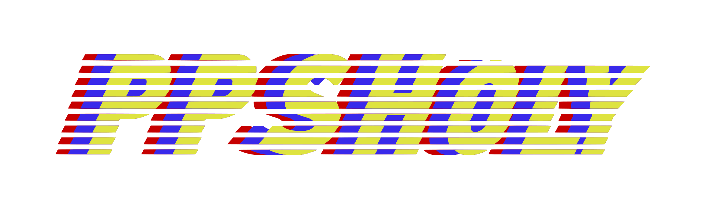

# PPSHoly

Browser games for Portage. A plain static site: no build step, no framework, no third-party scripts.
PPSHoly is not affiliated with Portage Public Schools.

## What is where

| Path | What it is |
| --- | --- |
| `index.html`, `css/style.css`, `js/app.js` | The home page: search, filters, recently played, light and dark theme |
| `js/games.js` | The game list. Add a game by adding one line |
| `play/` | The games themselves, one folder each |
| `icons/` | Game thumbnails (square, about 250px) |
| `assets/brand/`, `assets/fonts/` | Logo files and the two brand fonts, hosted with the site |
| `wrangler.jsonc`, `worker/`, `scripts/`, `.assetsignore`, `_headers` | Cloudflare deployment only |

To preview locally, serve the folder with any static server:

```bash
python3 -m http.server 8000
```

## Add a game

1. Put the game in `play/your-game/` with an `index.html`.
2. Put a square thumbnail in `icons/`.
3. Add a line to `js/games.js`:

```js
{"t": "Your Game", "u": "play/your-game/", "i": "icons/your-game.webp", "g": ["two"]},
```

`g` is optional and takes `pop`, `two`, `stream` or `bad`. A game with a missing thumbnail gets the P mark automatically.

## Deploy to GitHub Pages

1. In the repo, open **Settings → Pages**.
2. Under **Build and deployment**, pick **Deploy from a branch**, choose `main` and `/ (root)`, and save.
3. After a few minutes the site is live at `https://<user>.github.io/<repo>/`.

Every path in the site is relative, so it works under the `/<repo>/` prefix with no changes. The `.nojekyll` file tells GitHub to publish the files as they are.

GitHub asks that Pages sites stay under 1 GB, and this one is about 2.6 GB because of the games. It publishes today, but GitHub may ask you to slim it down.

## Deploy to Cloudflare

Cloudflare will not host a static file over 25 MiB, and 23 game files (about 845 MB in total) are bigger than that. So the deploy has two parts:

- Everything under 25 MiB is served as static assets from Cloudflare's CDN.
- The 23 large files go in an R2 bucket. A small Worker (`worker/index.js`) serves them at their original URLs, so no game needs editing.

One-time setup:

1. Turn on R2 in the Cloudflare dashboard (it asks for a payment method, but the first 10 GB of storage is free).

2. Sign in from the repo folder:

```bash
npx wrangler login
```

3. Create the bucket:

```bash
npx wrangler r2 bucket create ppsholy-big-files
```

4. Upload the large files (about 845 MB, so give it a while):

```bash
node scripts/big-files.mjs --upload
```

5. Deploy:

```bash
npx wrangler deploy
```

The site is then live at `https://ppsholy.<your-subdomain>.workers.dev`. To use your own domain, open the Worker in the dashboard and add it under **Settings → Domains & Routes**.

To redeploy on every push, open **Workers & Pages → ppsholy → Settings → Builds**, connect this GitHub repo, and leave the deploy command as `npx wrangler deploy`.

When you add a game with a file over 25 MiB, run step 4 again and commit the updated `.assetsignore`. The deploy stops with "Asset too large" if you forget.

## Docker

```bash
docker build -t ppsholy -f dockerfile . && docker run -p 8080:80 ppsholy
```

## Brand

Colours, type and logo rules come from the PPSHoly brand guide: red `#C60000`, blue `#3929EA`, yellow `#DEE340`, ink `#0D0B21`, paper `#F6F5EE`; Barlow Condensed ExtraBold Italic for headings and Barlow for text (both under the SIL Open Font License). Shapes lean 16 degrees, stripes are 7 parts on and 5 off, and corners stay square.
